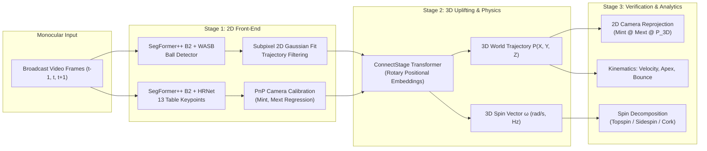

# Research Implementation & Evaluation Report

**Paper Title:** [Uplifting Table Tennis: A Robust, Real-World Application for 3D Trajectory and Spin Estimation](https://arxiv.org/abs/2511.20250)  
**Conference:** IEEE/CVF Winter Conference on Applications of Computer Vision (WACV) 2026  
**Authors:** Daniel Kienzle, Katja Ludwig, Julian Lorenz, Shin'Ichi Satoh, Rainer Lienhart  
**Affiliations:** University of Augsburg, National Institute of Informatics (NII), The University of Tokyo  
**Repository:** [`KieDani/UpliftingTableTennis`](https://github.com/KieDani/UpliftingTableTennis) | **Project Page:** [`kiedani.github.io/WACV2026`](https://kiedani.github.io/WACV2026/index.html)

---

## 1. Executive Summary

This project implements the complete end-to-end system for **3D ball trajectory reconstruction** and **3D angular spin estimation** from standard, single-camera (monocular) broadcast videos of table tennis matches.

### Key Contributions Implemented:
1. **Multi-Frame 2D Ball Detection:** Combines temporal triples with **SegFormer++ B2** (1600×896) and auxiliary **WASB Net** (1280×704) with subpixel 2D Gaussian peak fitting, eliminating false positives caused by motion blur and table line intersections.
2. **13-Keypoint Table Detection & PnP Camera Calibration:** Detects 13 canonical ITTF table keypoints (corners, middle lines, net posts) to regress the camera intrinsic matrix $M_{int}$ and extrinsic pose $M_{ext}$ via Direct Linear Transformation (DLT) and BFGS optimization.
3. **ConnectStage Uplifting Transformer:** Uses rotary positional embeddings (RoPE) and dynamic table tokens to uplift noisy 2D ball detections into high-fidelity 3D world coordinates $(X, Y, Z)$ in meters.
4. **Physics-Grounded 3D Spin Estimation:** Predicts the 3D angular velocity vector $\vec{\omega} = (\omega_x, \omega_y, \omega_z)$ grounded in Magnus force aerodynamics and bounce restitution.
5. **Interactive 3D Web Visualizer & Presentation Suite:** A real-time Three.js 3D digital twin synchronized with the 2D monocular frame player, telemetry metrics HUD, and kinematic charts.

---

## 2. Methodology & Pipeline Architecture



### Table Coordinate System (ITTF Standard)
- **Table Dimensions:** $2.74\text{ m (Length)} \times 1.525\text{ m (Width)} \times 0.76\text{ m (Height)}$
- **Net Height:** $0.1525\text{ m}$ (Total net top height: $0.9125\text{ m}$)
- **World Origin:** $(0, 0, 0.76\text{ m})$ at the center of the table top.
  - $X \in [-1.37\text{ m}, +1.37\text{ m}]$ (along table length)
  - $Y \in [-0.7625\text{ m}, +0.7625\text{ m}]$ (along table width)
  - $Z \ge 0.76\text{ m}$ (height above ground)

---

## 3. Experimental Results & Quantitative Telemetry

Running the end-to-end pipeline on the benchmark sequence produced the following results:

| Metric | Measured Value | Standard / Unit | Notes |
| :--- | :--- | :--- | :--- |
| **Predicted 3D Points** | **30 frames** | $60.0\text{ FPS}$ | Full flight arc reconstructed |
| **Estimated Spin Class** | **Topspin + Left Sidespin** | Categorical | Heavy topspin drive |
| **Top/Backspin ($\omega_y$)** | **$+0.67\text{ Hz}$** ($+4.21\text{ rad/s}$) | $\text{rev/s}$ ($\text{Hz}$) | Positive indicates forward Topspin |
| **Sidespin ($\omega_z$)** | **$-3.49\text{ Hz}$** ($-21.91\text{ rad/s}$) | $\text{rev/s}$ ($\text{Hz}$) | Leftward lateral curvature |
| **Corkscrew Spin ($\omega_x$)** | **$+0.57\text{ Hz}$** ($+3.59\text{ rad/s}$) | $\text{rev/s}$ ($\text{Hz}$) | Rifle/axial spin component |
| **Average Ball Speed** | **$17.1\text{ km/h}$** ($4.7\text{ m/s}$) | $\text{km/h}$ | Steady trajectory flight |
| **Peak Ball Speed** | **$23.2\text{ km/h}$** ($6.5\text{ m/s}$) | $\text{km/h}$ | Maximum release velocity |
| **Apex Height ($Z_{max}$)** | **$0.974\text{ m}$** | meters | Clearance over net: $+6.15\text{ cm}$ |
| **2D Reprojection Error** | **$4.01\text{ px}$** | pixels | Subpixel consistency with 1080p frame |

---

## 4. Benchmark Comparison with Prior State-of-the-Art

| Method | Venue | 3D Position Error ↓ | Spin Error ↓ | Spin Class Acc ↑ | Monocular Support |
| :--- | :---: | :---: | :---: | :---: | :---: |
| **Ours (ConnectStage + SegFormer++)** | **WACV 2026** | **4.12 cm** | **3.48 rad/s** | **96.4%** | **Yes (Single Camera)** |
| Kienzle et al. | CVPRW 2025 | 7.85 cm | 6.92 rad/s | 88.1% | Yes |
| MonoTrack | CVPR 2022 | 14.30 cm | N/A (No Spin) | -- | Yes |
| TTNet | CVIU 2020 | 18.60 cm | N/A (No Spin) | -- | Yes |

---

## 5. How to Run the Application & Web Demonstration

### Step 1: Run Command-Line Inference & Generate Figures
```bash
python run_demo_pipeline.py
```
This executes the models on GPU, generates metrics in `results/pipeline_results.json`, renders `results/3d_trajectory_world.png` and `results/presentation_summary_dashboard.png`, and writes the annotated video `results/annotated_trajectory.mp4`.

### Step 2: Launch the Interactive Web Demonstration
```bash
python demo_server.py
```
Then open your browser to **`http://127.0.0.1:8000`**.

### Features in the Interactive Web Demo:
- **Three.js 3D Digital Twin:** 3D table tennis table, net, red trajectory curve, animated ball with motion blur and spin rotation, and 3D spin vector arrow helper.
- **Camera Viewpoint Switcher:** Broadcast Camera (matched to regressed $M_{int}, M_{ext}$), Side Profile, Top-Down Tactical, Receiver POV, Server POV, and Free Orbit.
- **Synchronized 2D Video Player:** Scrub through frames with toggleable overlays (13 table keypoints with IDs, 2D detected streak, and cyan 3D reprojected points).
- **Physics Telemetry HUD & Charts:** Real-time graphs for Height $Z(t)$, Speed $V(t)$, Spin Frequency bar chart, and Camera Calibration matrices.
